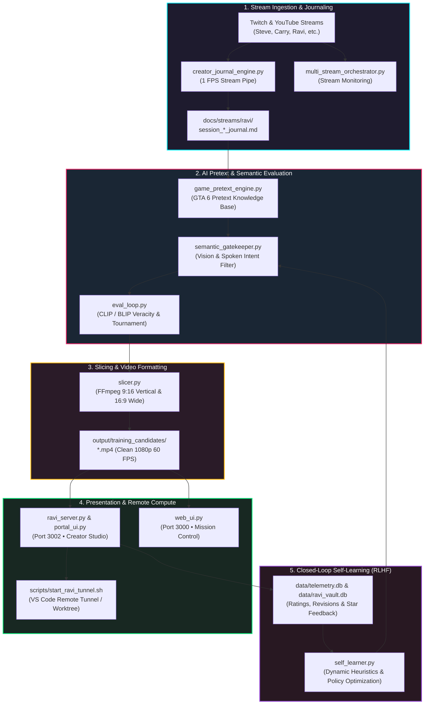
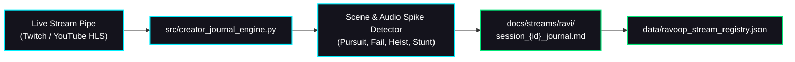
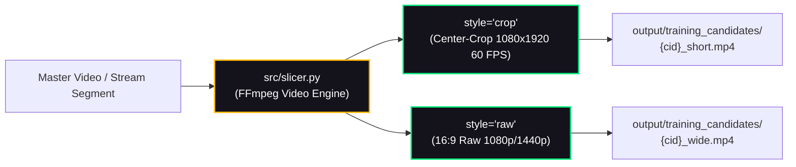
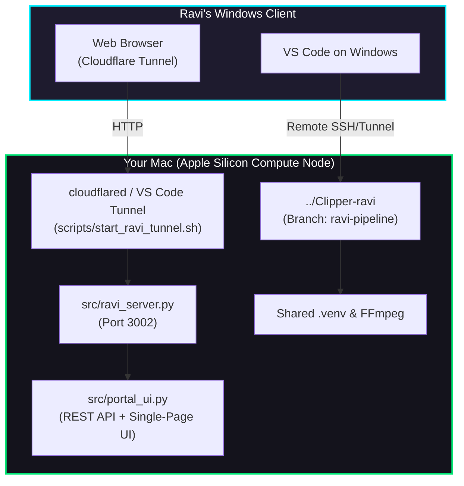

# Clipper — System Architecture & Module Map

This document maps out the architecture of the **Autonomous Stream Clipper** engine, detailing data flows, component boundaries, and which files to inspect when debugging or extending features.

---

## 🗺️ 1. High-Level System Architecture

The pipeline continuously monitors live streams, indexes moments at 1 frame per second (1 FPS) with vision classification, extracts viral segments, runs veracity scoring, and serves clean cuts to creator portals.



---

## 🧩 2. Subsystem Module Breakdowns

### Module A: Stream Ingestion & 1 FPS Context Journaling
Zero multi-GB video dump footprint on disk. Streams are read through piped FFmpeg streams at 1 FPS, generating second-by-second markdown chronicles.



- **Files to check**:
  - `src/creator_journal_engine.py`: 1 FPS pipe streaming & moment classification.
  - `src/multi_stream_orchestrator.py`: Multi-stream monitor and event deduplication matrix.
  - `docs/streams/ravi/session_*_journal.md`: Human-readable chronological moment timelines.

---

### Module B: AI Semantic Pretext & Veracity Gate
Decouples blind keywords from vision analysis by contextualizing scenes using dynamic GTA 6 mechanics.

```mermaid
flowchart LR
    RawQuery["User Search / Moment Tag"] --> Pretext["src/game_pretext_engine.py<br/>(data/game_pretext_gta6.json)"]
    Pretext --> Tokens["Expanded GTA 6 Tokens<br/>(e.g. Infiltration, Heat, Evasion)"]
    Tokens --> Gatekeeper["src/semantic_gatekeeper.py<br/>(Vision + Spoken Classifier)"]
    Gatekeeper --> Veracity["src/eval_loop.py<br/>(Anti-Trailer & Anti-GTA5 Guardrails)"]
    Veracity --> VerifiedClip["Verified Moment Candidate"]

    style Pretext fill:#14131C,stroke:#FF2A6D,stroke-width:2px,color:#FFF
    style Gatekeeper fill:#14131C,stroke:#FF2A6D,stroke-width:2px,color:#FFF
    style Veracity fill:#14131C,stroke:#FFB800,stroke-width:2px,color:#FFF
```



- **Files to check**:
  - `src/game_pretext_engine.py`: Grounded GTA 6 game systems and semantic query expansion.
  - `data/game_pretext_gta6.json`: System definitions (covert infiltration, wanted levels, water physics).
  - `src/semantic_gatekeeper.py`: Vision model prefixing & 17 CLIP system archetypes.
  - `src/eval_loop.py`: Tournament evaluator rejecting official cinematic trailers and legacy GTA 5 footage.

---

### Module C: Video Formatting & Slicer Engine
Produces clean, dual-format exports (16:9 Wide and 9:16 Vertical) without burned-in overlay clutter.



- **Files to check**:
  - `src/slicer.py`: FFmpeg cropping, scaling, and audio normalization.
  - `src/live_stream_pipeline.py`: Ingestion pipeline invoking the slicer with clean formatting (`overlay_text=None`).
  - `output/training_candidates/`: Active video cuts storage.

---

### Module D: Creator Studio Portal & Remote Compute Setup
Gives creator Ravi full control from Windows while utilizing Mac compute resources.



- **Files to check**:
  - `src/portal_ui.py`: Frontend HTML/CSS/JS, real-time client search filter, `KNOWN_MOMENTS_MAP`, and video resolution logic.
  - `src/ravi_server.py`: Dedicated lightweight HTTP daemon serving clips, streaming partial ranges (HTTP 206), and routing snip/query requests.
  - `scripts/start_ravi_tunnel.sh`: VS Code Remote Tunnel launcher.
  - `data/ravi_vault.db`: SQLite database storing candidate cuts, approval status, and critique notes.

---

## ⚡ 3. "What to Check For What" (Quick Debugging Guide)

| Symptom / Goal | Primary File to Inspect | Secondary File | Key Mechanism / Function |
| :--- | :--- | :--- | :--- |
| **Search returns wrong video cut** | `src/portal_ui.py` | `data/ravi_vault.db` | Check `KNOWN_MOMENTS_MAP` & topic fallback inside `snip_moment()`. |
| **Video looks squished (aspect ratio issue)** | `src/portal_ui.py` | `src/slicer.py` | Check `.video-container.vertical-mode` CSS (`aspect-ratio: 9/16; max-width: 315px;`). |
| **Overlay text/watermark visible on Short** | `src/slicer.py` | `src/live_stream_pipeline.py` | Check `overlay_text=None` and `style="crop"` in slicer call. |
| **AI fails to understand GTA 6 search query** | `src/game_pretext_engine.py` | `data/game_pretext_gta6.json` | Inspect `contextualize_user_query()` and token expansion dictionary. |
| **Stream candidate cuts not refreshing in portal** | `src/ravi_server.py` | `data/ravi_vault.db` | Inspect `GET /portal/api/ravi/clips` route and `get_ravi_candidate_clips()`. |
| **Ravi cannot connect from Windows** | `scripts/start_ravi_tunnel.sh` | Mac Terminal | Verify `code tunnel` status and check `git worktree list`. |
| **Creator feedback / critique not saving** | `src/portal_ui.py` | `data/ravi_vault.db` | Check `submit_ravi_feedback()` and SQLite update query. |
| **Mission Control Desktop UI (Admin)** | `src/web_ui.py` | `data/telemetry.db` | Port 3000 multi-threaded DualStack HTTP server and terminal WAL stream. |

---

## 📁 4. Clean Directory Map

```
Clipper/
├── ARCHITECTURE.md                  # This system architecture blueprint
├── README.md                        # Project introduction & quickstart
├── TODO.md                          # Active roadmap and pending tasks
├── AGENTS.md                        # Persistent agent directives & workspace context
├── pipeline.py                      # Main end-to-end multi-stream pipeline
│
├── src/                             # Core Python Engine
│   ├── game_pretext_engine.py       # GTA 6 dynamic mechanics & pretext expander
│   ├── creator_journal_engine.py    # 1 FPS piped stream context journaler
│   ├── semantic_gatekeeper.py       # Vision prompt & archetype classifier
│   ├── eval_loop.py                 # Tournament veracity gate (anti-trailer)
│   ├── slicer.py                    # FFmpeg video cropping (9:16 clean & 16:9 raw)
│   ├── portal_ui.py                 # Dedicated creator studio single-page app
│   ├── ravi_server.py               # Dedicated portal HTTP daemon (Port 3002)
│   ├── web_ui.py                    # Mission Control desktop interface (Port 3000)
│   ├── multi_stream_orchestrator.py # Multi-stream orchestrator & deduplication matrix
│   └── self_learner.py              # Active learning & heuristic updater
│
├── scripts/                         # Operational & Automation Utilities
│   ├── start_ravi_tunnel.sh         # VS Code Remote Tunnel launcher for Ravi
│   ├── process_ravi_revisions.py    # Creator feedback parser & re-slicer
│   └── ravoop_auto_pipeline.py      # Background ingestion daemon
│
├── data/                            # Persistent Databases & Catalogs
│   ├── ravi_vault.db                # SQLite WAL storage for Ravi's approved cuts
│   ├── telemetry.db                 # SQLite WAL storage for 100 candidate evaluations
│   ├── game_pretext_gta6.json       # Dynamic GTA 6 gameplay pretext definitions
│   └── curator_profiles/            # Creator-specific narrative profiles
│
├── docs/streams/ravi/               # Second-by-second markdown stream journals
└── output/training_candidates/      # Clean 1080p 60 FPS candidate video cuts
```
